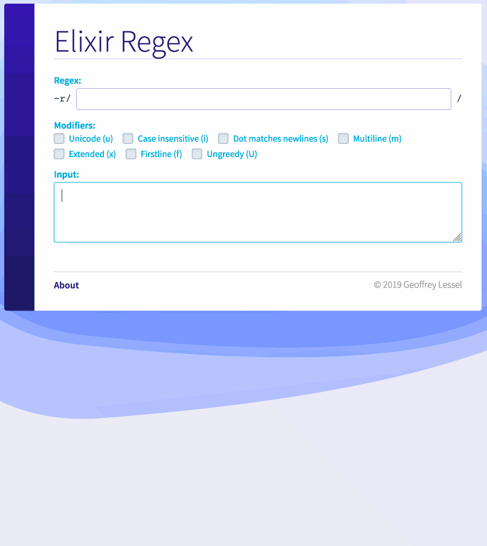

# Elixir Regex

This started as my entry in [Phoenix Phrenzy](https://phoenixphrenzy.com), showing off what [Phoenix](https://phoenixframework.org/) and [LiveView](https://github.com/phoenixframework/phoenix_live_view) can do.

Elixir Regex is a regular expression checker for Elixir. Simply put in your text and the expression you'd like to use as the regular expression, enable some optional modifiers, and see the results in real time. This application may not be very flashy, but it *is* very useful.



## Development

You need Elixir and Erlang. If you use [asdf](https://asdf-vm.com) or [mise](https://mise.jdx.dev), install the versions in `.tool-versions`. Node.js is not required: assets are bundled with [esbuild](https://hexdocs.pm/esbuild), which `mix setup` downloads.

  * Run `mix setup` to install dependencies and build assets
  * Start the server with `mix phx.server` or `iex -S mix phx.server`
  * Run `mix precommit` before committing (compile with warnings as errors, format, test)

Now you can visit [`localhost:4000`](http://localhost:4000) from your browser.

`mix setup` downloads esbuild from the npm registry. If that is not
possible, install esbuild yourself and set `MIX_ESBUILD_PATH` to it, for
example in an `.envrc` (ignored by git) for direnv:

```sh
npm install -g esbuild
echo 'export MIX_ESBUILD_PATH="$(which esbuild)"' >> .envrc
```

## Deploying

Production runs on a single server with [Kamal 2](https://kamal-deploy.org).
`kamal-proxy` on the server terminates TLS for every host name in
`config/deploy.yml` and only switches traffic to a new container once
`GET /up` returns 200.

The image is built by GitHub Actions, not by Kamal. On every push to
`main`, `.github/workflows/ci.yml` runs the tests and then builds an
x86_64 image tagged with the commit SHA and pushes it to Docker Hub. The
workflow needs a `DOCKERHUB_USERNAME` repository variable and a
`DOCKERHUB_TOKEN` repository secret.

Kamal reads the server's host name, the Docker Hub account and its
secrets from the environment (see `.kamal/secrets`, which holds variable
names only). Set them in an `.envrc` for direnv:

```sh
export KAMAL_SERVER_HOST=...         # the server Kamal deploys to over SSH
export KAMAL_REGISTRY_USERNAME=...   # the Docker Hub account that owns the image
export KAMAL_REGISTRY_PASSWORD=...   # a Docker Hub token
export SECRET_KEY_BASE=...           # from `mix phx.gen.secret`
```

Once CI has passed for the commit you have checked out:

```sh
kamal setup --skip-push    # first deploy: starts the app behind kamal-proxy
kamal deploy --skip-push   # every deploy after that
```

Kamal deploys the image whose tag matches `git rev-parse HEAD`, so deploy
from a clean checkout of a commit that CI has built.

The release reads `SECRET_KEY_BASE`, `PHX_HOST` (default
`www.elixirregex.com`) and `PORT` (default `4000`) at runtime.
